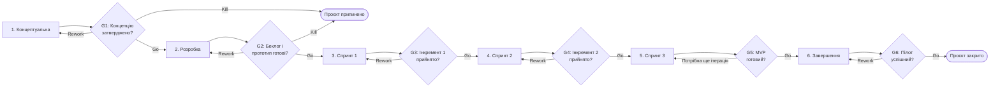
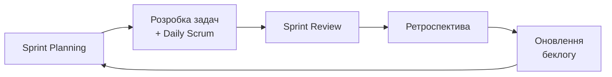

# Життєвий цикл проєкту: ХатаHub

## 1. Обрана модель життєвого циклу

- **Конкретна модель:** Scrum
- **Тип моделі за сучасною класифікацією (PMBOK 7):** адаптивна (Agile)

**Обґрунтування вибору.** У Лабораторній роботі №2 ХатаHub класифіковано як малий внутрішній веб-проєкт із середнім рівнем невизначеності вимог. Базові функції (чергування, заявки, оголошення) зрозумілі, але їхні пріоритети та зручність інтерфейсу уточнюватимуться після відгуків мешканців і адміністрації гуртожитку. Scrum дозволяє розбити розробку на короткі спринти по 2 тижні, після кожного з яких команда отримує працездатний інкремент і може змінити план. Малий розмір команди (5 осіб) і чітко розподілені ролі добре відповідають ролям Scrum: Product Owner керує беклогом, Project Manager виконує функції Scrum Master. Обмежений семестром час також краще використати ітеративно: навіть якщо не всі функції встигнуть, наприкінці буде готовий робочий MVP.

## 2. Фази життєвого циклу

Фаза «Виконання» класичної моделі представлена у вигляді трьох спринтів.

| № | Назва фази | Мета фази | Тривалість (тижнів) | Ключові роботи | Deliverables (проміжні результати) | Відповідальний |
|---|------------|-----------|---------------------|----------------|------------------------------------|----------------|
| 1 | Концептуальна (ініціація) | Сформулювати проблему, цілі та концепцію продукту, сформувати команду | 2 | Формування команди і ролей; вибір теми; опис проблеми й аудиторії; класифікація проєкту; аналіз оточення | `project-brief.md`, `project-classification.md`, GitHub-репозиторій | Project Manager |
| 2 | Розробка (планування) | Сформувати беклог продукту, план робіт і прототип інтерфейсу | 2 | Опитування мешканців; написання користувацьких історій; пріоритизація беклогу; прототипування у Figma; вибір технологічного стеку; налаштування GitHub Projects | Беклог продукту, прототип у Figma, план спринтів, обраний стек технологій | Product Owner |
| 3 | Виконання: Спринт 1 | Реалізувати основу системи та першу ключову функцію | 2 | Налаштування проєкту і БД; реєстрація через університетську пошту; профіль мешканця; графік чергувань | Інкремент 1: реєстрація, профілі, графік чергувань; Sprint Review | Developer |
| 4 | Виконання: Спринт 2 | Реалізувати комунікаційні функції | 2 | Звернення до адміністрації зі статусами; дошка оголошень; панель адміністратора | Інкремент 2: заявки, оголошення, адмін-панель; Sprint Review | Developer |
| 5 | Виконання: Спринт 3 | Реалізувати додаткові функції та сповіщення | 2 | Обмін речами; бронювання спільних приміщень; Telegram-бот і push-сповіщення; виправлення дефектів | Інкремент 3: повна версія MVP; Sprint Review | Developer |
| 6 | Завершення | Протестувати продукт, запустити пілот і підбити підсумки | 2 | Тестування з реальними мешканцями; виправлення критичних помилок; розгортання на хостингу; презентація; ретроспектива проєкту | Розгорнутий MVP, звіт про тестування, презентація, звіт із ретроспективи | Analyst + Project Manager |

**Загальна тривалість проєкту:** 12 тижнів.

Дизайнер упродовж усіх спринтів готує макети екранів для наступного спринту, а аналітик уточнює вимоги та готує тестові сценарії.

## 3. Ворота між фазами

| Ворота | Між фазами | Критерії переходу | Можливі рішення |
|--------|------------|-------------------|-----------------|
| G1 | Концептуальна → Розробка | Сформовано команду й розподілено ролі; `project-brief.md` і `project-classification.md` погоджені з викладачем; тему затверджено без повторів з іншими командами | Go / Rework / Kill |
| G2 | Розробка → Спринт 1 | Беклог містить не менше 15 користувацьких історій з пріоритетами; прототип ключових екранів готовий; стек технологій обрано; задачі Спринту 1 заплановано в GitHub Projects | Go / Rework / Kill |
| G3 | Спринт 1 → Спринт 2 | Реєстрація, профілі та графік чергувань працюють і продемонстровані на Sprint Review; немає критичних дефектів; беклог оновлено за відгуками | Go / Rework / Kill |
| G4 | Спринт 2 → Спринт 3 | Заявки до адміністрації, оголошення й адмін-панель працюють; функціонал погоджено з Product Owner; беклог оновлено | Go / Rework / Kill |
| G5 | Спринт 3 → Завершення | Усі функції MVP реалізовані (Definition of Done виконано); застосунок розгорнуто на тестовому сервері; немає блокувальних дефектів | Go / Rework / Kill |
| G6 | Завершення → Закриття проєкту | Пілотне тестування проведено; критичні помилки виправлено; презентацію здано; ретроспективу проведено, документацію оновлено в репозиторії | Go / Rework |

**Kill** розглядається, якщо продукт втрачає сенс: наприклад, адміністрація відмовляється від використання системи, а мешканці не підтверджують потребу в ній.

## 4. Візуалізація життєвого циклу

Кожен спринт усередині має однаковий цикл Scrum:

## 5. Обґрунтування вибору моделі

На вибір моделі найбільше вплинули такі характеристики проєкту з Лабораторної роботи №2: середній рівень невизначеності вимог, малий розмір команди, відсутність грошового бюджету та жорстке обмеження часу одним семестром. Вимоги до продукту залежать від відгуків мешканців і позиції адміністрації гуртожитку, які стануть відомі лише в процесі роботи. Тому потрібна модель, що дозволяє регулярно показувати проміжний результат користувачам і коригувати план без значних втрат.

Команда розглядала кілька альтернатив. **Каскадна модель (Waterfall)** та **V-подібна** були відхилені, бо вимагають повністю зафіксованих вимог на старті, а будь-яка зміна наприкінці проєкту була б дорогою; крім того, робочий продукт з'явився б лише в останні тижні семестру. **Спіральна модель** надмірна для малого навчального проєкту: її формальний аналіз ризиків на кожному витку займає забагато часу. **Макетування** частково використовується у фазі розробки (прототип у Figma), але як самостійна модель не дає готового продукту. **Kanban** підходить для підтримки, але без фіксованих спринтів команді студентів складніше дотримуватися дедлайнів і звітувати викладачу.

Переваги Scrum для ХатаHub: після кожного спринту є працездатний інкремент, який можна показати викладачу та мешканцям; пріоритети легко змінювати між спринтами; ролі команди природно відповідають ролям Scrum; регулярні ретроспективи допомагають команді з малим досвідом швидко вчитися на власних помилках. Найцінніші функції (графік чергувань, заявки) реалізуються першими, тому навіть при нестачі часу продукт залишиться корисним.

Потенційні ризики моделі: недооцінка обсягу робіт у спринті через брак досвіду; нерегулярність зустрічей через навчальне навантаження; «розповзання» обсягу через постійні нові побажання; слабка документованість, характерна для Agile. Для їх мінімізації команда планує брати в спринт не більше 70–80% оцінної ємності, проводити короткі зустрічі двічі на тиждень онлайн, приймати нові вимоги лише через беклог із рішенням Product Owner, а ключові рішення фіксувати в Markdown-документах у репозиторії. Ворота G1–G6 додають до Scrum контрольні точки, у яких команда разом із викладачем свідомо вирішує, чи переходити далі.
